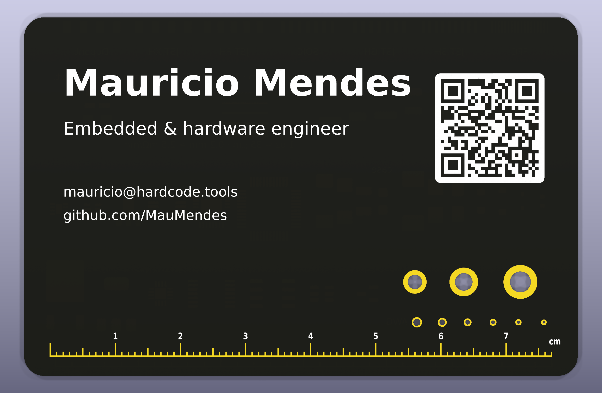
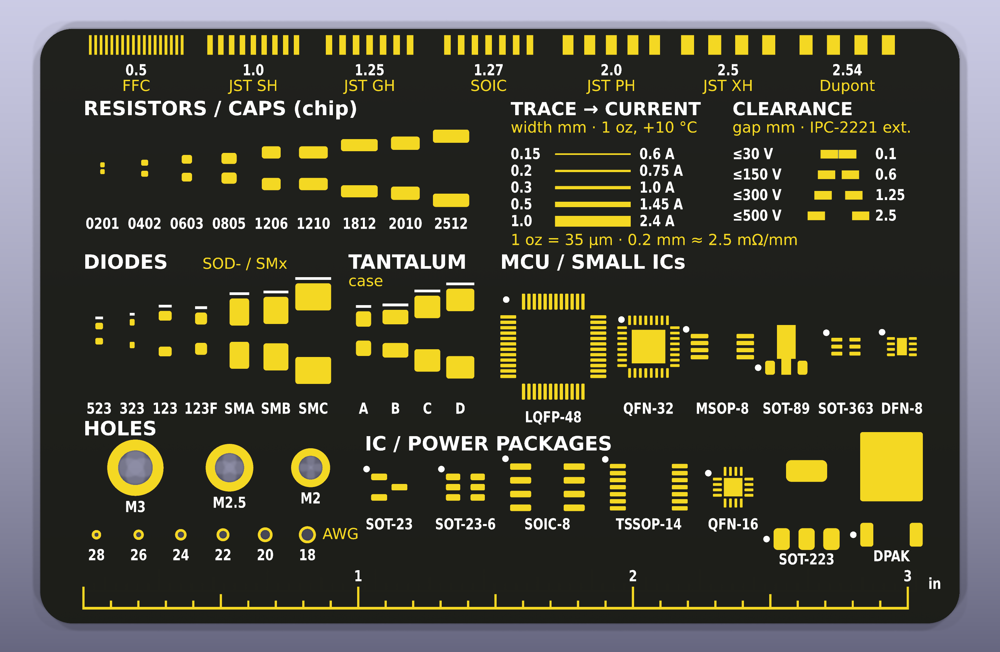

# PCB business card (KiCad 10)

My personal business card as a PCB – and a pocket reference for the bench.

 

**Back side (all exposed ENIG copper, real size):** pin-pitch combs with connector names (FFC, JST SH/GH/PH/XH, Dupont), chip R/C 0201–2512, diodes SOD-523…SMC, tantalum A–D, IC packages SOT-23…LQFP-48 with pin-1 marks, trace width → current (1 oz, +10 °C), voltage → clearance (IPC-2221 external), M2/M2.5/M3 holes, AWG 28–18 wire-gauge holes, cm and inch rulers.

## Board
85 × 55 mm · R3 corners · 2 layers · 0.8 mm FR-4 · black mask · white silk · ENIG

## Cost (JLCPCB, Oct 2026)
30 cards, 2 layers, 85 × 55 mm, 0.8 mm, black mask, before shipping:

| Finish | Price | Per card |
|---|---|---|
| **ENIG** (gold) | €33.57 | ~€1.12 |
| HASL (silver) | €15.80 | ~€0.53 |

ENIG is recommended – the exposed gold copper is the design, and it doesn't oxidise.

## Make your own
1. Open `oss_card.kicad_pro` in KiCad 10.
2. Edit the front text and regenerate the QR (`the QR text in `tools/build_card.py`, then `python3 tools/build_card.py``).
3. Run DRC, export gerbers + drill, zip.
4. Order as a 2-layer board: 0.8 mm, black, ENIG (see `fab/ORDER_NOTES.txt`).

Note: the 0.1 mm clearance demo sits at typical minimum spacing – keep it exact or widen to 0.13 mm.

## License
Hardware: [CERN-OHL-P-2.0](https://ohwr.org/cern_ohl_p_v2.txt) · Scripts: MIT
